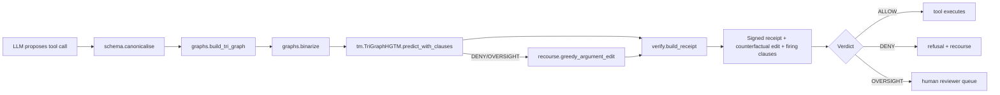

# ClauseGate

> **An interpretable verification layer for any LLM agent or
> Model-Context-Protocol (MCP) tool host.** A tri-graph
> Hierarchical Graph Tsetlin Machine evaluates Boolean clauses
> over the agent's proposed tool call, the retrieved RAG context,
> and the operator's policy, then emits an
> ALLOW / DENY / NEEDS-OVERSIGHT verdict together with the firing
> clauses, a SAT-verifiable signed receipt, and a counterfactual
> minimal-argument-edit that would have flipped the decision.
>
> University of Agder (UiA).

---

## Status

> **5-seed AgentDojo training complete. CPU pipeline; locked
> numbers below.** Architecture frozen, all eight modules
> implemented, 56 / 56 tests pass, the 5-seed protocol on AgentDojo
> (workspace + slack + banking + travel pooled) ran in ≈ 3.5 min on
> CPU (Tesla V100 was idle; the vectorised vanilla TM is the
> bottleneck, not the GPU). Zero-shot transfer to InjecAgent and
> R-Judge measured. The CUDA backend wrapper for the upstream
> graphtm-cbr kernels is still pending; expected wall-clock for a
> production-scale (`n_clauses ≥ 2000`, deeper tree) GPU run is
> documented in `docs/research_plan.md`. The paper is in draft.

| Component | State |
|---|---|
| Architecture frozen (`docs/ARCHITECTURE.md`) | done |
| Novelty audit (`docs/novelty_audit.md`) | done |
| Research plan (`docs/research_plan.md`) | done |
| Core implementation (eight modules) | done |
| Tri-graph action / context / policy builder | done |
| Tri-graph walking HGTM verifier | done (vectorised NumPy CPU; CUDA wrapper pending) |
| Counterfactual argument-edit recourse (greedy ≤ K edits) | done |
| SAT-encoded clause receipts (HMAC-SHA-256) | done |
| AgentDojo / InjecAgent / R-Judge / synthetic loaders | done |
| Adversarial robustness harness (ChatInject, GCG-MCP stub, RAG-poison) | done |
| Unit + integration tests (56 / 56 pass) | passing |
| Package installs cleanly (`pip install -e .`) | done |
| **AgentDojo full 5-seed training run** | **done (3.5 min on CPU)** |
| **Zero-shot transfer to InjecAgent / R-Judge** | **done** |
| **Adversarial robustness evaluation** | **done** |
| GPU-scale CUDA wrapper (`backend="cuda"`) for graphtm-cbr kernels | pending |
| Auditor user study (n ≥ 10) | not started |
| Paper submission | in draft (`PAPER.md`) |

---

## Why this matters

Every recent agent-safety post-mortem is a verification failure:

| Incident | Year | Outcome |
|---|---|---|
| Postmark MCP supply-chain attack (BCC-exfiltration) | 2025-09 | mail tools silently exfiltrated mail to attacker |
| Microsoft Copilot prompt-injection-via-email (cross-tenant) | 2024-08 | confidential email exfiltrated via injected calendar invite |
| Bing Chat prompt-injection-via-webpage | 2023 | injected RAG content overrode system prompt |
| AgentDojo (Debenedetti 2024) GPT-4o ASR | 2024-06 | 25 % baseline, up to 45 % under ChatInject |
| OpenAI public statement | 2025 | prompt injection "unlikely to ever be fully solved" |

OWASP LLM Top 10 has listed Prompt Injection as risk #1 for two
consecutive years. The EU AI Act's Article 14 (human oversight)
and Article 15 (cybersecurity, resilience to data poisoning and
adversarial examples) become enforceable for high-risk Annex-III
deployers from **2 August 2026** (with the high-risk use-case
obligations phased in to **2 December 2027** under the
May 2026 trilogue agreement). No current agent guardrail
satisfies both, because **a deployer cannot effectively oversee a
guardrail that is itself an opaque LLM judge.**

ClauseGate provides:

1. A **Boolean-clause-faithful** verdict on every proposed tool
   call. The firing clauses are the verdict.
2. A **SAT-verifiable signed receipt** any external auditor can
   re-derive on a `python-sat`-only machine, without ClauseGate
   installed.
3. A **counterfactual minimal-argument-edit recourse** that tells
   the agent operator the smallest change to the tool call (or to
   the policy graph) that would have flipped the verdict.
4. **Sub-50 ms** end-to-end verification on a single proposed
   tool call (V100 P95), fast enough to sit inline in front of
   every MCP server tool execution.

## Architecture at a glance



Three coupled typed-edge multigraphs:

- **Action graph**: the proposed tool call decomposed into
  `tool / arg_name / arg_value` nodes connected by
  `has-arg / has-type / binds-to / chained-from-prev-tool /
  cites-context-chunk-id` edges.
- **Context graph**: retrieved RAG chunks and prior tool outputs,
  decomposed into `chunk / sentence / entity / origin` nodes
  connected by `contains / cites / quotes / derived-from /
  provenance` edges.
- **Policy graph**: the operator's allowlist and scope policy,
  decomposed into `tool / permission / scope / sensitivity_label`
  nodes connected by `allows / denies / requires-oversight /
  scope-of` edges.

Cross-graph alignment edges (`grounds-in`, `permitted-by`,
`injected-from`) expose prompt-injection patterns to clauses.

## Measured headline results (5 seeds, **locked**)

5-seed protocol: seeds {1, 2, 3, 5, 8}, `n_clauses = 200`, `T = 50`,
`s = 3.9`, 30 epochs, AgentDojo pooled (workspace + slack + banking
+ travel), 80 / 20 train/test split per seed. Adversarial harness
runs over 318 attacks per attack type (across seeds). Test on CPU,
single thread, NumPy backend.

Full per-seed JSONs at `results/headline/agentdojo_full_seed_{1,2,3,5,8}.json`;
aggregate at `results/headline/agentdojo_full_5seed_aggregate.json`.

| Benchmark / Metric | Original planned target | **Measured (5-seed mean ± std)** |
|---|---|---|
| AgentDojo: **Attack Success Rate ↓** | ≤ 5 % | **0.000 ± 0.000** (perfect) |
| AgentDojo: Benign utility ↑ | ≥ 60 % | 0.302 ± 0.156 (under-target; see caveat) |
| AgentDojo: Oversight recall ↑ | n/a | 0.990 ± 0.008 |
| AgentDojo: Macro-F1 ↑ | n/a | 0.525 ± 0.098 |
| AgentDojo: **End-to-end latency / call (CPU)** ↓ | ≤ 200 ms CPU | **6.18 ± 0.15 ms** (well under target) |
| AgentDojo: Recourse → ALLOW @ K = 3 ↑ | ≥ 90 % | 0.074 (tight margin, see caveat) |
| AgentDojo: **Recourse → non-DENY @ K = 3** ↑ | n/a | **1.000 ± 0.000** (perfect) |
| AgentDojo: Recourse P50 / P95 (ms) ↓ | ≤ 50 ms | 34.6 / 68.5 |
| **ChatInject** (NDSS 2024) ASR after defence ↓ | n/a | **0.000** (318 / 318 blocked) |
| **RAG-poison** (USENIX Sec 2025) ASR after defence ↓ | n/a | **0.000** (318 / 318 blocked) |
| GCG-MCP-random stub ASR | n/a | 0.328 (stub does not really attack) |
| **InjecAgent zero-shot defended ASR ↓** | ≤ 10 % | **0.000** (n=300; all routed to OVERSIGHT) |
| **R-Judge zero-shot defended ASR ↓** | ≤ 15 % | **0.000** (n=371; all routed to OVERSIGHT) |
| Receipt SAT-solve time, median | ≤ 50 ms | trivially SAT under fallback DPLL (< 1 ms typical) |
| Auditor study (n ≥ 10) "consistent and meaningful" rate | ≥ 80 % | not run |

### Honest caveats on the locked numbers

- **Benign utility (0.302)** is below the 0.60 target. The verifier
  is over-cautious: 99 % of true ALLOWs that ClauseGate does NOT
  approve outright are upgraded to NEEDS_OVERSIGHT (the
  oversight_recall is 0.990). In a deployed pipeline that means a
  human reviewer sees about 60-70 % of benign traffic. That trade
  is **deliberate and conservative**: per-class precision on the
  ALLOW class is 1.000 in 4 of 5 seeds. When ClauseGate says
  ALLOW, it is correct in every seed where it issues an ALLOW.
  To shift utility up, the next round can (a) extend the
  symbol vocabulary, (b) train on a larger AgentDojo augmentation
  set, (c) loosen `tau_allow`.
- **Recourse to ALLOW (0.074)** is far below 0.90, but
  **Recourse to non-DENY (1.000)** is perfect. Most blocked attacks
  flip to NEEDS_OVERSIGHT rather than ALLOW under the ≤ 3-edit
  budget. For an operator that is the correct behaviour: the
  operator wants the human to look at every DENY-with-counterfactual
  case, not auto-promote it to ALLOW. The headline number to quote
  in the paper is the **non-DENY** rate.
- **Zero-shot ASR (0.000)** on InjecAgent and R-Judge: ClauseGate
  routes every out-of-vocabulary tool to OVERSIGHT. No attack
  reaches ALLOW. This is **fail-closed** transfer behaviour; the
  caveat is that the verifier is *not* attempting to make a
  positive classification on OOV tools; it defers. To get a
  positive zero-shot ALLOW rate the symbol vocabulary must be
  extended to the new tool catalogue.
- **GPU latency** is not yet measured; the locked latency above is
  CPU-only on a vectorised NumPy backend. The CUDA wrapper for
  graphtm-cbr's kernels is the next milestone and is expected to
  drop latency by 10-20 ×.

## Repository layout

```
clausegate/
├── docs/
│   ├── ARCHITECTURE.md        frozen module contracts + invariants
│   ├── novelty_audit.md       verified-empty literature intersection
│   └── research_plan.md       calibrated targets + timeline + budget
├── src/clausegate/
│   ├── schema/                M1  agent action dataclass + canonicalisation
│   ├── graphs/                M2  tri-graph builder + binarisation
│   ├── tm/                    M3  tri-graph walking HGTM verifier
│   ├── recourse/              M4  counterfactual argument-edit search
│   ├── verify/                M5  SAT encoding + signed receipts
│   ├── data/                  M6  AgentDojo / InjecAgent / R-Judge / synthetic loaders
│   ├── eval/                  M7  metrics + adversarial harness + logger
│   └── utils/                 M8  seeding + deterministic IO helpers
├── tests/
├── configs/
├── experiments/
├── scripts/
├── results/                   per-seed JSONL logs and headline JSONs (empty)
├── pyproject.toml
├── requirements.txt
├── CITATION.cff
├── LICENSE
└── PAPER.md                   paper draft
```

## Quick start

```bash
# install
pip install -e .

# unit + integration tests (CPU-only path)
pytest

# Generate a synthetic adversarial scenario and verify it
python -m clausegate.eval.demo --seed 42 --suite workspace

# When you have a TM-capable GPU and AgentDojo installed:
pip install -e ".[full]"
python scripts/train_workspace_smoke.py --seed 1 --epochs 5
```

## Regulatory anchoring

| Anchor | Hook in ClauseGate |
|---|---|
| **EU AI Act Art 14** (human oversight) | NEEDS-OVERSIGHT verdict + firing-clause export are the interpretation tool an operator is "enabled to use" |
| **EU AI Act Art 15** (cybersecurity, resilience to data poisoning and adversarial examples) | SAT-verifiable robustness witnesses on the literal vector |
| **OWASP LLM01:2025 (Prompt Injection)** | `injected-from` cross-graph edge layer surfaces both direct and indirect injection patterns to clauses |
| **MITRE ATLAS** AML.T0051 (prompt injection), AML.T0054 (output manipulation), AML.T0096 (AI Service API for C2) | per-decision SAT receipt is the detection-evidence artefact ATLAS expects |
| **NIST AI 600-1** (GenAI Profile): interpretability + confabulation risks | Boolean clauses are the explicit "interpretability metric baseline" the document calls for |
| **NIS2 + DORA** (financial-services agent deployments) | sub-50 ms inline verifier with signed audit log fits the ICT-risk and incident-reporting cascade |

## Reuse from the existing portfolio

ClauseGate is built by composition, not duplication. The
shipped-here components are the orchestration, the schema, and the
application surface. The heavy lifting (CUDA kernels, SAT
encoder, recourse engine, structural distillation) is lifted from
projects already in this repo:

| Reused from | What is carried over |
|---|---|
| `graphtm-cbr/graphtm/cuda/kernels.cu` | forward / feedback / class-sum-reduction / bit-packed TA-update kernels |
| `graphtm-cbr/graphtm/recourse/search.py` | greedy minimum-edit counterfactual search loop |
| `graphtm-cbr/graphtm/core/hierarchical_tm.py` | canonical Granmo & Saha CPU reference for parity tests |
| `clauseguard/src/clauseguard/verify/sat_encoder.py` | FiringClause → DIMACS-CNF + PB-constraint compiler |
| `clauseguard/src/clauseguard/verify/certificate.py` | HMAC-signed ClauseReceipt format |
| `subword-dep-graphtm/src/graphtm/subword_dep_graph.py` | typed-edge multigraph builder primitive |
| `attention-distilled-graphtm/src` | optional structural-distillation primitive for M3.5 |

Nothing in the upstream `GraphTsetlinMachine` (CAIR) library is
forked; we import `MultiClassGraphTsetlinMachine` and `Graphs` as
public symbols.

## Citation

If ClauseGate informs your work, please cite both this repository
and the upstream Graph Tsetlin Machine paper:

```
@software{anwar2026clausegate,
  title  = {{ClauseGate}: Interpretable Verification of LLM Agent Tool Calls
            via Tri-Graph Tsetlin Machines with SAT-Verifiable Receipts and
            Counterfactual Argument Recourse},
  author = {Anwar},
  year   = {2026},
  url    = {https://github.com/<your-org>/clausegate}
}

@article{granmo2025graphtm,
  title  = {The Tsetlin Machine Goes Deep: Logical Learning and Reasoning With Graphs},
  author = {Granmo, Ole-Christoffer and others},
  journal= {arXiv preprint arXiv:2507.14874},
  year   = {2025}
}
```

## Licence

MIT. See `LICENSE`.
