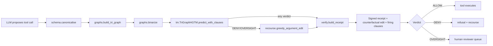

# ClauseGate: Architecture Contract

Single source of truth. Every module ships against the interfaces
below; integration is gated on these contracts.

## Pillar

A **tri-graph walking Hierarchical Graph Tsetlin Machine** (HGTM)
that simultaneously evaluates Boolean clauses on three coupled
typed-edge multigraphs:

1. an **Action graph**: the agent's proposed tool call decomposed
   into typed `tool/arg/value` nodes and `binds-to / has-type /
   chained-from` edges;
2. a **Context graph**: the retrieved RAG chunks and prior tool
   outputs the agent observed, decomposed into typed
   `chunk/entity/origin` nodes and `cites / quotes / derived-from`
   edges;
3. a **Policy graph**: the operator's allowlist and tool-semantic
   policy, decomposed into typed `tool/permission/scope` nodes and
   `allows / requires-oversight / denies` edges,

plus cross-graph alignment edges (`grounds-in`, `permitted-by`,
`injected-from`) that make prompt-injection patterns syntactically
visible to a clause.

ClauseGate emits an ALLOW / DENY / NEEDS-OVERSIGHT verdict per
proposed tool call together with (a) the firing clauses, (b) a
SAT-verifiable signed receipt, and (c) a counterfactual minimal
argument edit that would have flipped the verdict.

## Stack

- **CUDA-C kernels** are lifted from
  `graphtm-cbr/graphtm/cuda/kernels.cu` (forward, feedback,
  class-sum reduction, bit-packed TA updates). The per-node feature
  tensor now carries three source-graph labels (action / context /
  policy) and the same compile-time geometry shape as in
  graphtm-cbr's HGraphTM (`[R, IA, IF, LA, 2*LF]`).
- **Python orchestration**: GraphTsetlinMachine (CAIR), NumPy host
  glue, NetworkX (graph operations), python-sat (Glucose 4 solver).
  Optional PyTorch only for the BERT/CodeBERT structural teacher
  used in the topology-distillation experiment (M3.5); training the
  TM itself never requires PyTorch.
- **Reference CPU**: `clausegate.tm.hierarchical_tm` is a canonical
  Granmo & Saha port (mirrors graphtm-cbr's reference) used for
  numerical-parity tests of the CUDA path.

## Module map (eight modules)

```
src/clausegate/
  schema/       M1  AgentAction dataclass + canonicalisation + JSON I/O
  graphs/       M2  tri-graph builder (action + context + policy) + binarisation
  tm/           M3  tri-graph walking HGTM verifier (+ optional structural distill)
  recourse/     M4  counterfactual argument-edit search (≤K edits, greedy)
  verify/       M5  SAT-encode clauses + sign clause receipts (HMAC-SHA-256)
  data/         M6  AgentDojo / InjecAgent / R-Judge / synthetic loaders
  eval/         M7  metrics (ASR, utility, F1, ECE), adversarial harness, logger
  utils/        M8  seeding, deterministic IO helpers
```

Every module ships with its own `tests/test_<module>.py` and a
public `__init__.py` whose docstring is the **frozen interface**.
Crossing a module boundary at runtime means going through one of
the symbols listed in its `__all__`. The integration suite asserts
the invariants below; CI rejects any patch that breaks them.

## Invariants (enforced by tests/test_integration)

1. **Action round-trip:** `serialise(parse(call_json)) == call_json`
   on a fixed seed of 100 AgentDojo samples after canonicalisation
   (sorted keys, lower-cased tool names, args ordered by canonical
   name).
2. **Graph isomorphism under arg permutation:** for any permutation
   of `kwargs`, the tri-graph emitted by `M2.build_tri_graph` is
   isomorphic (NetworkX `nx.is_isomorphic` with node + edge type
   match) to the canonical-order tri-graph. The verdict and the
   firing clause ids must be identical.
3. **CUDA-CPU parity:** forward output of the CUDA HGTM matches the
   NumPy reference within 1 vote unit on a fixed seed of 32
   AgentDojo training examples. Test is `@pytest.mark.cuda` and
   skipped when CUDA is absent.
4. **No silent CPU fallback:** if `cuda.is_available()` is `False`
   and the caller passed `--device cuda`, the first device
   operation raises `RuntimeError` (graphtm-cbr invariant carried
   over).
5. **SAT-receipt determinism:** for a fixed model version, the
   tuple `(action_graph_hash, context_graph_hash, policy_graph_hash,
   model_version_id)` uniquely determines the verdict, the firing
   clause ids, and the literal-vector hash; replaying the same
   tuple produces a byte-identical receipt body (signature varies
   only with the signing key).
6. **Recourse correctness:** if `M4.recourse` returns
   `RecourseOutcome(found=True, edits=E, latency_ms=L)`, then
   re-running `M3.predict` on the action+context graph with `E`
   applied flips the verdict in the direction requested (DENY → ALLOW
   or vice versa). Test verifies on 200 synthetic cases.
7. **Receipt verifiability without ClauseGate installed:** the
   reference auditor script `experiments/verify_receipt.py` runs on
   a vanilla Python + `python-sat` venv and re-derives the recorded
   verdict from the recorded literal vector + CNF + firing clause
   ids alone.
8. **Latency budget:** end-to-end verification (graph build →
   HGTM forward → recourse → SAT encode → signed receipt) on a
   single proposed tool call is **≤ 50 ms** on one V100 and
   **≤ 200 ms** on CPU-only, for the headline 5-clause-tree HGTM
   spec. Stress test in `tests/test_latency.py` records P50/P95 on a
   1000-call fixture and fails CI if regressed by > 25 %.
9. **Permission-invariance:** ClauseGate never persists the
   operator's HMAC signing key on disk; tests assert that the key
   appears only in environment variables and is never logged.

## Verdict semantics

Three classes, with deterministic tie-breaking:

| Verdict | When emitted | Downstream contract |
|---|---|---|
| **ALLOW** | clause score for ALLOW exceeds DENY *and* NEEDS-OVERSIGHT by ≥ `tau_allow` (default 5 votes) | tool call may execute; receipt logged |
| **DENY** | clause score for DENY is the argmax and the margin over ALLOW is ≥ `tau_deny` (default 3 votes) | tool call is refused; counterfactual edit + receipt returned to operator |
| **NEEDS-OVERSIGHT** | argmax with margin < `tau_oversight`, or NEEDS-OVERSIGHT is argmax | tool call paused; human reviewer receives receipt + ranked firing clauses |

NEEDS-OVERSIGHT is the EU AI Act Article 14 contract surface: it
is the explicit "interpretation tool available" the operator must
be enabled to use. Below-margin DENY upgrades to NEEDS-OVERSIGHT
by design.

## Tri-graph schema (M2)

Action graph nodes: `{tool, arg_name, arg_value_literal,
arg_value_symbol}`. Edges: `{has-arg, has-type, binds-to,
chained-from-prev-tool, cites-context-chunk-id}`.

Context graph nodes: `{chunk, sentence, entity, prior_tool_output,
origin}`. Edges: `{contains, cites, quotes, derived-from,
provenance}`.

Policy graph nodes: `{tool, permission, scope, sensitivity_label}`.
Edges: `{allows, denies, requires-oversight, scope-of}`.

Cross-graph edges: `{grounds-in (action → context),
permitted-by (action → policy), injected-from (context → action,
emitted only by adversarial fixtures)}`.

A binarisation layer (M2.binarize) thermometer-encodes scalar args
(numeric thresholds) and one-hot-encodes string-enum args; the
output is the symbol stream expected by `GraphTsetlinMachine.Graphs`.

## Frozen interfaces (excerpt)

```python
# clausegate.schema
@dataclass(frozen=True)
class AgentAction:
    tool: str
    args: dict[str, Any]
    prior_tool_outputs: tuple[ToolOutput, ...] = ()
    rag_chunks: tuple[Chunk, ...] = ()
    policy_id: str = "default"

def canonicalise(action: AgentAction) -> AgentAction: ...
def to_json(action: AgentAction) -> str: ...
def from_json(blob: str) -> AgentAction: ...

# clausegate.graphs
def build_tri_graph(action: AgentAction, policy: Policy) -> TriGraph: ...
def binarize(tg: TriGraph, vocab: Vocab) -> BinaryFeatures: ...

# clausegate.tm
class TriGraphHGTM:
    def fit(self, X: list[TriGraph], y: np.ndarray, *, epochs=100) -> "TriGraphHGTM": ...
    def predict(self, X: list[TriGraph]) -> np.ndarray: ...
    def predict_with_clauses(self, X: list[TriGraph]) -> PredictionWithClauses: ...

# clausegate.recourse
def recourse(
    action: AgentAction, policy: Policy, model: TriGraphHGTM,
    target_verdict: int, *, max_edits: int = 3, max_latency_ms: int = 50,
) -> RecourseOutcome: ...

# clausegate.verify
def build_receipt(
    action: AgentAction, policy: Policy, prediction: PredictionWithClauses,
    *, signing_key: bytes,
) -> ClauseReceipt: ...
def verify_receipt(receipt: ClauseReceipt, *, signing_key: bytes | None = None) -> bool: ...
```

The full signatures live in each module's `__init__.py` and are
enforced by `tests/test_interfaces.py`.

## Data flow



## Threat model

In scope:
- **Indirect prompt injection** via RAG chunks or prior tool
  outputs (OWASP LLM01:2025, the #1 LLM risk for 2 years).
- **Tool-call parameter tampering** (Postmark MCP supply-chain
  attack pattern, Sept 2025).
- **Composed-tool jailbreaks**: chains of innocent tools that add
  up to a policy-violating effect.
- **Forged-receipt detection**: adversary modifies receipt fields
  post-decision.

Out of scope (delegated to a separate trusted-log protocol):
- Proving the deployer did not log a different decision than they
  enforced. That requires an append-only transparency log; we ship
  the receipt format that such a log can ingest, but the log
  protocol itself is future work.
- Prompt-injection that is also clause-consistent (i.e., the
  attacker exploits a true rule of the system). This is policy
  bug, not verifier bug; ClauseGate exposes the firing clause so
  the operator can patch the policy graph.

## Pipeline composition with the existing portfolio

| Component | Source | What ClauseGate reuses |
|---|---|---|
| CUDA-C HGTM kernels (forward, feedback, class-sum) | graphtm-cbr | wholesale; only per-node feature tensor schema changed |
| Tri-graph host orchestration (memory, bit-pack) | graphtm-cbr | adapted (3-source label vector) |
| SAT encoder (FiringClause → DIMACS, PB constraint compiler) | clauseguard | wholesale |
| HMAC-signed ClauseReceipt | clauseguard | adapted (action/context/policy hashes) |
| Greedy minimal counterfactual edit search | graphtm-cbr | adapted (argument-edit ops instead of bond ops) |
| Typed-edge multigraph schema | subword-dep-graphtm | adapted (tool/arg/chunk instead of BPE/dep) |
| Structural-distillation primitive (optional M3.5) | attention-distilled-graphtm | adapted (BERT-attention over agent transcripts) |

Nothing in the GraphTsetlinMachine upstream library is forked; we
import `MultiClassGraphTsetlinMachine` and `Graphs` as-is.

## Non-goals

- We do **not** train an LLM. ClauseGate operates on already-emitted
  agent actions; the LLM is a black box upstream.
- We do **not** classify the LLM's natural-language reasoning. The
  verdict is on the structured tool-call action; reasoning-text
  goes into the context graph only as evidence chunks.
- We do **not** ship an MCP server. We ship a verifier library
  with a thin reference adapter; productionisation behind a
  specific MCP transport is left to the deployer.
